<p align="center">
  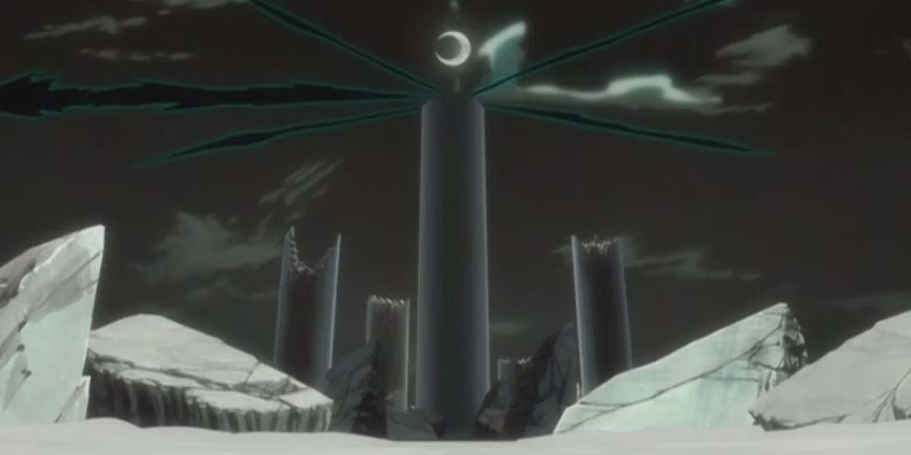
</p>

<p align="center">
  <a href="#whoami">[ whoami ]</a> &nbsp;·&nbsp;
  <a href="#arsenal">[ arsenal ]</a> &nbsp;·&nbsp;
  <a href="#source-code">[ source code ]</a> &nbsp;·&nbsp;
  <a href="#projetos">[ projetos ]</a>
</p>

<p align="center"><samp>Hide in the fog</samp></p>

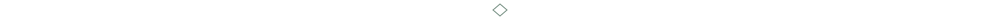

<h2 id="whoami">01 / whoami</h2>

```console
yhwach@fog:~$ cat identity.txt
alias       : Yhwach / Fog
name        : Eduardo Castro Assad
education   : Cybersecurity @ FIAP
focus       : Red Team / Offensive security
status      : Evolving / Adapting / Studying
strengh     : Curiosity
weakness    : Curiosity / liking Bleach a bit too much
```

**"Destruction is the prelude to creation"**

Gosto de testar os limites da segurança de sistemas e encontrar falhas, desde a arquitetura até a rede, e do codigo até a vulnerabilidade. Nenhuma blindagem é infalivel, e se não é infalivel, eu posso e eu vou dar um jeito de atravessar.

PS: Sou um grande entusiasta de Hardware Hacking.

<h2 id="arsenal">02 / arsenal</h2>

<p>
  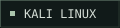
  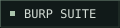
  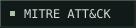
  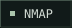
  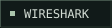
</p>

| Diretório | Ferramentas e referências dos meus estudos |
| :--- | :--- |
| `~/offensive` | Burp Suite · Nmap · Metasploit · Nikto · John the Ripper · dirb |
| `~/network` | Wireshark · OpenSSL · BIND9 · Apache |
| `~/appsec` | Semgrep · Gitleaks · SonarQube · OWASP Dependency-Check · Qualys |
| `~/systems` | Kali Linux · Debian · RedHat · Ubuntu · AlmaLinux · Windows · Git · VS Code |
| `~/low-level` | NASM · GDB · Arduino IDE · Raspberry Pi Pico |
| `~/reference` | MITRE ATT&CK — referência para táticas e técnicas adversárias |

<h2 id="source-code">03 / source code</h2>

<p>
  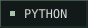
  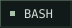
  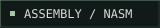
  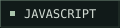
  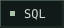
</p>

<samp>Linguagens presentes nos meus estudos e projetos.</samp>

<h2 id="projetos">04 / projetos</h2>

**NOXUS ASPM 360°**  
Projeto acadêmico FIAP × PRIDE Security: integração de análises de segurança e centralização de achados de aplicações.

</details>

<br />

<p align="center"><samp>Hide in the fog</samp></p>

